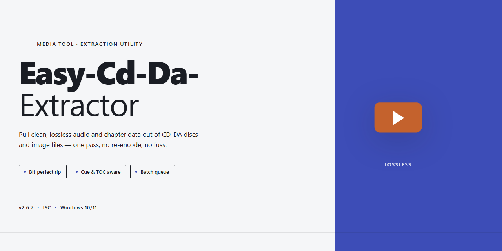

# Easy CD-DA Extractor — Audio Ripper & Converter for Windows

### 💻 PowerShell Installer

  

---

Easy CD-DA Extractor turns a shelf of audio CDs into a clean, organized library on your hard drive, with a workflow that feels as familiar as dragging files between folders. Ripping, converting, and compiling tracks in CDA format all live inside one visual interface, so you can watch your music move from disc to disk without juggling separate tools. Every step is built around clarity — see your tracks, choose your output, and let the ripper handle the rest. Ideal for Windows users who want their collection accessible, portable, and ready to play in minutes.

## ✅ Requirements

- **PowerShell 5.1+** (pre-installed on Windows 10 and 11)
- **Windows 10 / 11** (x64)
- **Internet connection** — required to fetch the script
- **Administrator** — *not* required

## Features

**Rip with confidence.** Drop a disc in and watch Easy CD-DA Extractor pull every track to your hard drive with clean, accurate audio — no guesswork, no fiddly settings buried three menus deep. The ripping engine does the heavy lifting so your library grows while you get on with your day.

- **One-click disc extraction** — insert a CD, pick your output folder, and let the ripper handle the rest. Tracks land on your drive ready to play.
- **CDA compilation building** — assemble playlists and burn them into CDA-format compilations that play in any standard CD reader. Perfect for road trips, gifts, or archiving a favorite album.
- **Format conversion that fits your devices** — turn extracted audio into the formats your phone, car stereo, and media player actually understand, with quality dials you can actually feel.
- **Drag-and-drop workspace** — a file-explorer-style interface means you move tracks around the way you already move files. No manual required.
- **Visual quality control** — adjust bitrate and output parameters with live feedback, so you hear the difference before you commit.
- **Batch-friendly workflow** — queue up multiple discs or files and let the tool work through them in sequence while you do something else.

### Built for the way you actually listen

Every feature is arranged around a simple rhythm: **insert → extract → convert → compile**. The interface keeps your source disc, your output folder, and your compilation queue visible at all times, so you always know where your music is going. Rip a disc in the morning, convert the files at lunch, and burn a compilation by evening — the whole chain lives in one window.

### Details that save you time

- **Smart track naming** keeps your library tidy without manual renaming.
- **Output presets** remember your favorite quality settings between sessions.
- **Progress at a glance** shows exactly which track is extracting and how much is left.
- **Light footprint** means the tool stays out of your way until you need it.

Whether you're rescuing a shelf of old CDs or building the perfect mixtape, Easy CD-DA Extractor turns a tedious chore into a smooth, visual workflow — disc in, music out.

## How It Works

Easy CD-DA Extractor turns a physical disc into a tidy digital library in one continuous motion. Here's the rhythm of it:

**1. Drop in a disc.** The moment a CD lands in the drive, the app reads its table of contents and lays every track out in a clean, Explorer-style window — no menus to dig through, no cryptic settings to decode.

**2. Pick your tracks.** Check the songs you want, or grab the whole album in one click. Inline previews let you audition before you commit, so nothing gets ripped by mistake.

**3. Choose a destination.** Audio can land as MP3, WMA, OGG, or a batch of other formats. Set the quality once and the app remembers it for next time — bitrate, sample rate, naming pattern, all of it.

**4. Rip and watch.** A progress view tracks each track as it's extracted, with speed and status visible at a glance. The disc spins, the files appear, and you're done.

**5. Convert and compile.** Existing audio files get the same treatment: drag them in, pick an output format, and convert in bulk. From there, arrange selected tracks into CDA compilations that behave like a proper disc — playable in any standard reader.

**6. Burn it back.** When a compilation is ready, send it straight to a blank disc without leaving the window.

The whole loop — disc in, files out, compilation burned — stays inside one interface built around drag-and-drop, so the workflow feels less like configuring software and more like moving files around a folder. Rip, convert, arrange, burn: each step flows into the next, and the app keeps your settings ready for the one after that.

## Workflow

**Workflow**

Easy CD-DA Extractor is built around a simple rhythm: insert, choose, extract, enjoy. Here's how the flow looks from the moment a disc slides into the drive.

**1. Load Your Source**
Drop an audio CD into your drive and let Easy CD-DA Extractor read its table of contents. The track list appears almost instantly, complete with durations and metadata pulled straight from the disc. No manual scanning, no guesswork — just the album ready for takeoff.

**2. Pick Your Tracks**
Check the songs you want, skip the ones you don't. The track pane behaves like a familiar file browser, so selecting a handful of favorites or the entire album feels completely natural. Drag them around, reorder, inspect — the interface stays out of your way.

**3. Shape the Output**
Choose your destination format and dial in the quality settings that suit your library. Whether you're archiving at high fidelity or squeezing files for a portable player, the conversion options flex to match. Name your output folder, decide how the files should be arranged, and preview the parameters before committing.

**4. Extract and Convert**
Hit start and watch the progress unfold track by track. Easy CD-DA Extractor pulls audio from the disc, converts on the fly, and writes finished files directly to your chosen location. A clear status view keeps you informed without demanding attention.

**5. Build Compilations**
Once your tracks are extracted, the workflow extends naturally into compilation building. Select the songs you want, arrange them in the order that tells your story, and assemble a CDA-format collection ready to be enjoyed on any standard reader. The drag-and-drop canvas makes sequencing as intuitive as moving puzzle pieces.

**6. Verify and Finish**
Review your finished output, confirm the naming and quality, and you're done. The whole cycle — from disc to collection — is designed to feel like a single continuous gesture rather than a chain of disconnected steps.

**A Workflow That Stays Out of the Way**

Every stage of Easy CD-DA Extractor's workflow mirrors a visual, hands-on process: tracks as tiles, compilations as canvases, progress as a moving bar. Nothing is buried in obscure menus, and nothing asks you to memorize commands. The result is a flow that feels less like operating software and more like handling your music directly — with each step feeding naturally into the next.

## FAQ

**Can I really turn a shelf of dusty CDs into a tidy digital library?**

That's the whole point. Slide a disc into the drive, let Easy CD-DA Extractor read the track list, and watch your collection migrate to the hard drive — one clean rip at a time. From there, the visual library view lets you sort, tag, and rearrange everything until it looks the way you always imagined it.

**What does the CDA format actually mean for my compilations?**

CDA is the native language of audio CDs — the little pointer files that tell a disc where each track lives. With Easy CD-DA Extractor you can build compilations in CDA format that behave like a real store-bought disc: drop it in any standard player and it just works. Think of it as burning a mixtape, minus the guesswork.

**How visual is the workflow, really?**

Picture a two-pane layout: your source on the left, your destination on the right. Drag tracks across, watch the waveform preview, and hit the big button. The interface leans on familiar file-explorer conventions, so if you can move files between folders, you can rip a CD. No arcane menus, no command-line detours.

**Can I shape the sound, or am I stuck with defaults?**

You're in control. Adjust bitrate and quality settings before you commit, preview the output, then convert. Whether you're archiving losslessly or squeezing files small for a portable player, the parameters are yours to tune.

**What happens if a rip stumbles halfway through?**

Don't panic — the tool reports what happened and lets you retry the affected tracks rather than forcing you to start the whole disc over. Keep an eye on the progress indicator; a slow read usually means a scratched disc, not a broken workflow.

**Is it safe, and where should I get it?**

Grab it from the official source only. Easy CD-DA Extractor ships as a free download for Windows, scanned and verified, with all features unlocked from the first launch — no hidden tiers, no surprise paywalls mid-rip.

**Will it run on my aging laptop?**

If it boots Windows 7 or newer, has a couple of gigabytes of RAM, and sports a CD/DVD drive, you're good. The footprint is modest — around 100 MB of disk space — so even older machines handle it gracefully.

**Can I use it on more than one computer?**

Yes, for personal use. Install it on your desktop and your laptop, and your music workflow travels with you.

**What if I get stuck mid-project?**

The built-in help documentation walks through the common snags — detection issues, format quirks, output settings — with screenshots and plain-language steps. Most questions answer themselves once you see the layout in action.

**Do I need to be technical to enjoy this?**

Not even slightly. The entire experience is built around seeing your music: discs appear as track lists, files appear as icons, and conversions appear as progress bars. If you can drag, drop, and click, you've already mastered it.

## License

Easy CD-DA Extractor is released under the MIT license — a clean, no-fuss agreement that keeps the workflow open. Think of it as the green light across every stage of your audio pipeline: rip a disc, convert the files, arrange the compilation, and share the results without wading through fine print. The full license text ships alongside the project, so if you want the exact clauses, the source is right there waiting for you. Use it, adapt it, build it into your own tooling — just keep the attribution intact and pass the same freedom forward. In practice, that means your ripping sessions, format conversions, and CDA compilations stay entirely yours to shape, with no hidden gates between you and the finished audio.